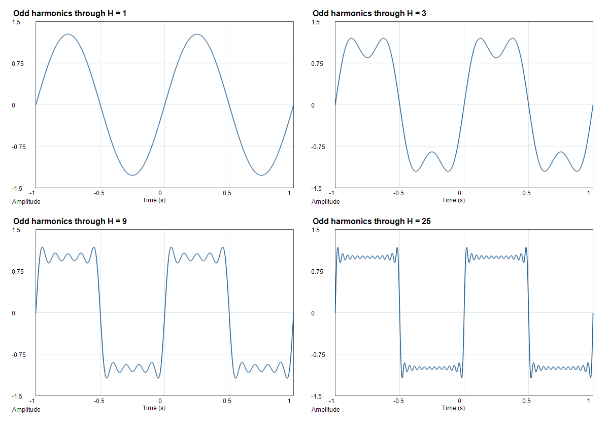
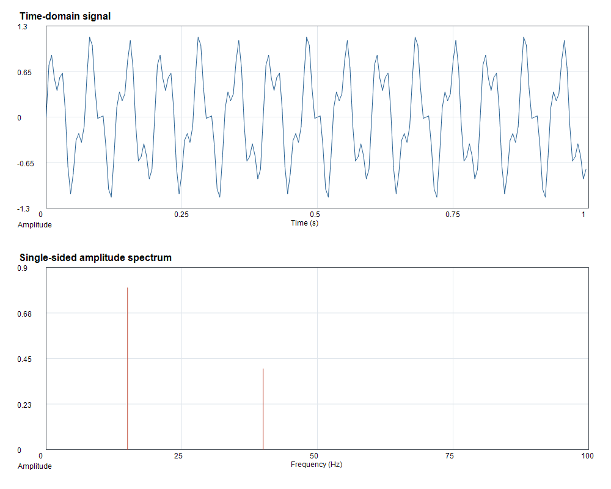
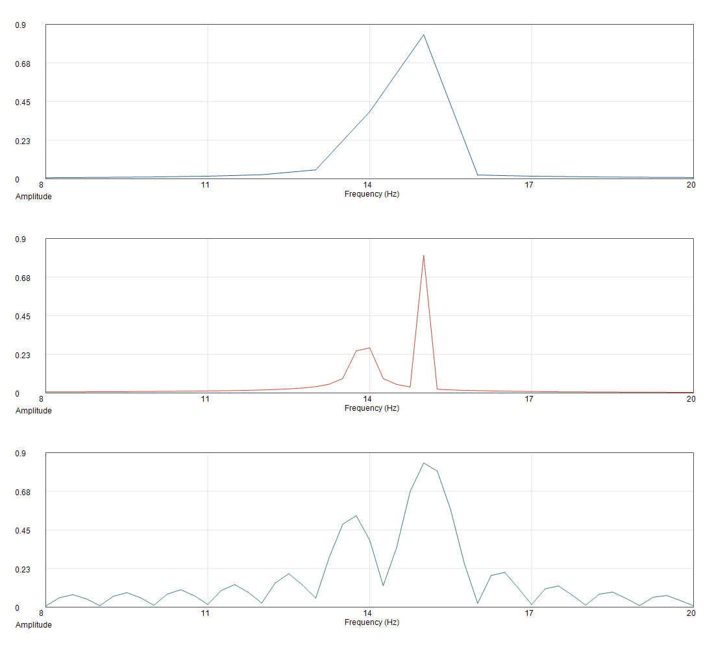
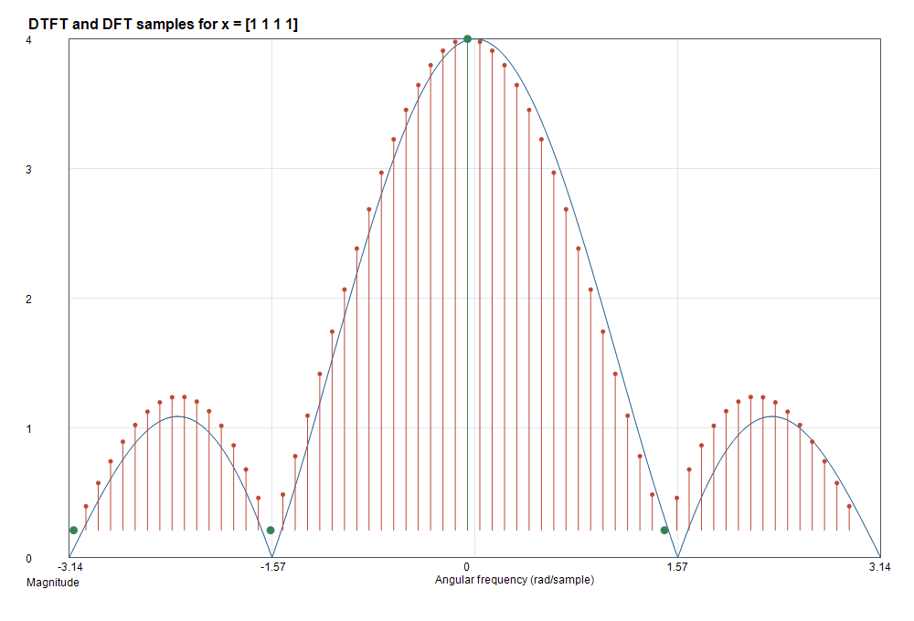

# Lecture 5: Fourier Assignment

MATLAB exercises on Fourier series, the FFT/DFT, and spectral leakage.

Run each `.m` script in MATLAB to reproduce its figure. The PNGs in this folder are reference plots generated from the same equations without MATLAB; the MATLAB scripts themselves were not run for this commit.

## Exercise 1: Build a square wave from harmonics

**Prediction.** Adding more odd harmonics should make the flat parts and sharp transitions of the approximation look more like an ideal square wave. The waveform remains periodic with period 1 second.

**What the reference plot shows.** H = 1 is a sine wave. H = 3 and H = 9 add progressively sharper edges and flatter high and low sections. H = 25 looks closer still. Near each jump, oscillations become concentrated in a narrower region while a small overshoot remains. This is the Gibbs phenomenon: a finite Fourier sum cannot reproduce a discontinuity exactly.

## Exercise 2: Find two frequencies with the FFT

**Prediction.** The signal contains 15 Hz at amplitude 0.8 and 40 Hz at amplitude 0.4.

There are N = 200 samples and fs = 200 Hz, so the frequency-bin spacing is

`Δf = fs/N = 200/200 = 1 Hz`.

Both frequencies lie exactly on DFT bins. The single-sided spectrum has peaks at 15 Hz and 40 Hz with amplitudes 0.8 and 0.4 respectively, matching the signal construction. The time plot shows the sum of both sinusoids.

## Exercise 3: Investigate spectral leakage

**Digit used for the reference plot: d = 4.** Replace this with your own last digit before submission. For d = 4, `f2 = 13.2 + 0.17(4) = 13.88 Hz`.

**Prediction.** Since 13.88 Hz does not complete an integer number of cycles in a one-second record, its energy spreads across nearby DFT bins instead of appearing in one bin. The largest bin will not necessarily equal the sinusoid's amplitude.

At 200 Hz sampling, the one-second record has 200 samples and `Δf = 200/200 = 1 Hz`. The four-second record has 800 samples and `Δf = 200/800 = 0.25 Hz`. The longer record observes more cycles, so its frequency grid is finer and the peak is more localized. Leakage sidelobes remain because 13.88 Hz is not exactly on the four-second grid either; its nearest 0.25 Hz bin is 14.00 Hz.

Zero-padding the one-second record to 800 FFT points gives a plotted grid spacing of `200/800 = 0.25 Hz`. The curve looks smoother and its sampled maximum can be closer to the true peak. Padding only interpolates the spectrum of the original one-second record. It adds no signal samples and does not improve the underlying frequency resolution or remove leakage.

## Exercise 4: Compare the DTFT and DFT

For `x = [1 1 1 1]`, the DTFT is a smooth curve over continuous frequency. `fft(x,4)` samples it at four equally spaced DFT frequencies; only the DC sample has magnitude 4, while the other three have magnitude 0. `fft(x,64)` samples the same DTFT at 64 frequencies, so those points trace the smooth curve more densely. It does not add samples to `x`; it zero-pads the four-sample sequence for the transform.

The DTFT magnitude is zero at `ω = ±π/2` and at `ω = ±π` over `[-π, π]` (the endpoints represent the same periodic frequency).

## AI use

AI helped organize the MATLAB scripts and draft the explanations. The scripts were not run in MATLAB for this commit. The PNG reference plots were calculated from the signal equations without MATLAB; the results should be checked by running the scripts in MATLAB before class submission.
